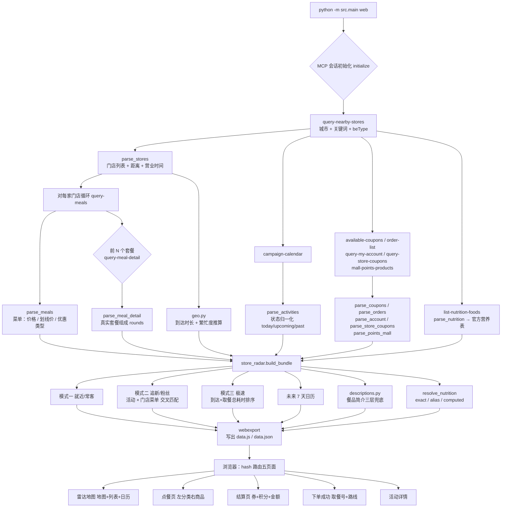

# 麦当劳 MCP 集成说明

> 本文说明「麦麦雷达地图」**实际使用**的麦当劳 MCP Server、Tool、调用流程与业务价值。
> 参赛要求：文件名必须为 `MCP_INTEGRATION.md`。

---

## 一、使用的 MCP Server

| 项 | 值 |
| --- | --- |
| Server 名称 | `mcd-mcp` |
| 接入方式 | `streamablehttp` |
| Endpoint | `https://mcp.mcd.cn` |
| 鉴权 | `Authorization: Bearer <MCD_MCP_TOKEN>`（环境变量注入，不落盘） |
| 客户端实现 | 官方 `mcp` Python SDK（`mcp.client.streamable_http`） |
| 官方仓库 | <https://github.com/M-China/mcd-mcp-server> |

脱敏配置见 [`mcp-config.example.json`](./mcp-config.example.json)。
客户端封装见 [`src/mcp_client.py`](./src/mcp_client.py)。

---

## 二、使用的 Tool

本项目**真实调用**以下 11 个麦当劳 MCP Tool（全部为**只读**工具）：

| # | Tool | 用途 | 调用点 |
| --- | --- | --- | --- |
| 1 | `query-nearby-stores` | 按城市 + 位置关键词查附近门店（含距离、营业时间、预约能力） | `web`（核心） |
| 2 | `query-meals` | 拉取**每家门店**的菜单（含价格、划线价、优惠类型、图片） | `web`（对 5 家店各调一次） |
| 3 | `campaign-calendar` | 拉取营销活动日历（进行中 / 往期 / 未来） | `radar` / `calendar` / `web` |
| 4 | `available-coupons` | 拉取可领取的麦麦省优惠券列表 | `radar` / `coupons` / `web` |
| 5 | `order-list` | 拉取本人历史订单（含**套餐子项** `comboItemList`） | `web` 常客排序 / 历史订单置顶 / 顶栏用户面板 / 「你常点」标记 |
| 6 | `query-my-account` | 拉取积分账户全字段（可用 / 累计 / 过期 / 已用 / 冻结 / 各期将过期 / 账户 ID） | `web` 顶栏用户面板 · 结算页积分换购 |
| 7 | `query-store-coupons` | 拉取**指定门店**可用券（含券码、有效期、适用商品） | `web` 模式三 / 结算页 |
| 8 | `auto-bind-coupons` | 一键领取全部可领优惠券 | `bind` 命令 |
| 9 | `query-meal-detail` | 拉取单个餐品的**真实组成与特调项** | `web` 点餐页商品详情弹窗 |
| 10 | `list-nutrition-foods` | 拉取**官方营养成分表**（热量 / 蛋白 / 脂肪 / 碳水 / 钠 / 钙） | `web` 点餐页热量标注与详情弹窗 |
| 11 | `mall-points-products` | 拉取**积分商城**可换购商品券（积分 + 指定金额） | `web` 结算页积分换购区块 |

> 麦当劳 MCP 共提供 35 个 Tool。本项目只选用与「选店 / 选品 / 活动 / 算价」直接相关的 11 个。
> **`create-order`、`cancel-order`、`calculate-price`（写路径）、`draw-lottery`、`mall-create-order`
> 等会产生真实交易或积分消耗的调用一律未接入** ——
> 不涉及下单、支付、抽奖与积分消耗，避免任何资金风险与过度授权。
> 前端展示的「下单成功页」是**本地演示流程**，订单号与取餐号均为前端生成，页面已明确标注。
> 页面上新增的「**取消订单**」同样只在本地改状态，**不会调用 `cancel-order`**，弹窗里有醒目标注。

### 城市覆盖：MCP 侧是全国，快照侧才是一个城市

`query-nearby-stores` 在 `searchType=2` 时要求 `city` + `keyword` 同时给。实测结论：

| 城市 | 关键词 | 返回 |
| --- | --- | --- |
| 上海 | 人民广场 | 5 家（黄浦华旭国际大厦 / 福州路 / 食品一店 / 雅居乐 / 南京西路 NX258） |
| 北京 | 国贸 | 5 家（建外 SOHO A 座 / 光华东里 / 景辉街 / 光华路世纪财富中心 / 景华南街） |
| 广州 | 天河城 | 5 家（今日广场 / 维多利广场 / 正佳五楼 / 正佳三楼 / 体育东潮流站） |
| 杭州 | 西湖 | 5 家（灵隐景区 / 岳庙北山街 / 岳庙码头 / 西湖银泰 / 滨江天寓） |
| 深圳 | 腾讯滨海大厦 | 5 家（本快照所用） |

所以「只有深圳」不是 MCP 的限制，而是**离线快照按一次查询固化**的结果。换城市只要重跑：

```bash
python -m src.main web --city 上海 --keyword 人民广场
python -m src.main web --city 北京 --keyword 国贸
```

前端页面上的城市下拉只切换**地图视角**，不会重新发起 MCP 请求（纯静态页面不持有 Token）。

### 三个「补齐信息」的工具怎么用

麦当劳 MCP 的 `query-meals` 只给**名字 / 价格 / 图片**，不给简介、热量和套餐组成。这三块由新增的工具补齐：

* **`query-meal-detail`** → 拿到 `rounds`（如「主食任选 1 项」）。前端在商品详情弹窗里还原成
  「套餐组成 · 任选 N 项」，并标出来源。目前对 4 个代表性套餐做了抓取（巨无霸、麦乐鸡 5 块、
  麦辣鸡腿汉堡三件套、堡堡随心拼），导出时**限量 8 个**，避免数据包膨胀。
* **`list-nutrition-foods`** → 官方营养表按**规格全名**逐条列出（「中薯条」而不是「薯条」），
  而套餐**没有独立条目**。因此匹配分三档并如实标注来源：
  `exact`（官方原值）/ `alias`（别名参考，如「薯条」→「中薯条」）/ `computed`（按官方组成累加）。
  **套餐尤其不能拿单个汉堡的热量顶替**——本项目在 `resolve_nutrition()` 里对套餐关闭了近似匹配，
  改走组成累加；只要有一个组成项查不到，就整体放弃而不是给「只累加了一半」的数字。
* **`mall-points-products`** → 拿到积分换购项（形如「巨无霸 100 积分 + ¥10」）。
  由于麦当劳积分是**换购**而非折现，结算页做的是「换购方案推荐」：只推荐积分够用、
  购物车里正好有对应商品、且算下来确实更省的方案。

### 为什么每家门店都要单独调一次 `query-meals`

菜单接口是**按门店**返回的，同一餐品的价格和供应情况会因门店而异。这一点被直接用于产品能力：

* 模式二回答「哪些店有售这个限时新品」——例如 `蘸酱韩式甜辣酱鸡块` 在 1420944 / 1420504 / 1420094 有售，
  但 **1420728（海岸城西区）与 1420919（厚德品园）没有**；
* 模式三回答「哪家店能买全我选的东西，并且最快」——缺货的门店会被降权并标注。

---

## 三、调用流程



1. **建立会话** — `Authorization: Bearer <token>` 建 streamable-HTTP 连接并 `initialize`。
2. **定门店** — `query-nearby-stores`（`searchType=2` 按位置搜，`beType=1` 到店自取）拿到门店与距离。
3. **拉菜单** — 对每家门店调 `query-meals`，得到该店的真实菜品与价格。
4. **拉活动 / 券 / 订单 / 积分 / 积分商城** — 并行获取，构建用户画像与营销上下文。
5. **补营养与套餐组成** — `list-nutrition-foods` 拿官方营养表；再挑前几个套餐调 `query-meal-detail` 拿真实组成（限 8 个）。
6. **算指标** — `geo.py` 按距离与时段推算到达时长、繁忙度、取餐等待。
7. **组装三模式** — `store_radar.build_bundle()` 输出前端需要的全部结构，并为每个餐品挂上简介与热量。
8. **导出** — `webexport.write_assets()` 写出 `web/data.js`（同时给 `data.json`）。
9. **渲染** — 浏览器端按 hash 路由分五个页面：雷达地图 / 点餐 / 结算 / 下单成功 / 活动详情。

### 关键实现约束（开发时真实踩到的点）

- **返回不是纯 JSON**：`campaign-calendar` / `available-coupons` 返回 Markdown 文本；
  `query-nearby-stores` 返回「说明文字 + JSON」混合体。`src/mcp_client.extract_payload()` 做三层还原
  （结构化字段 → `Original Response` 标记后 JSON → 花括号截取），`src/parsers.py` / `src/catalog.py` 再做语义解析。
- **价格字段单位为「分」**：`calculate-price` 返回的价格需 ÷100。而 `query-meals` 的
  `currentPrice` / `originalPrice` 直接是**元**（字符串），两者的量纲不同，不能混用。
- **门店标识分两段**：`storeCode` + `beCode`。到店自取（`beType=1`）不带 `beCode`；
  得来速（5）/ 麦乐送（2）/ 团餐（6）必须带，且 `storeCode` 必须纯数字。
- **`beType` 是全局枢纽**：决定 `orderType`（1 到店 / 2 外送）以及要不要传 `beCode`。
  本项目默认走 `beType=1`，因此 `orderType=1` 且不传 `beCode`。
- **门店经纬度恒为 0.0**：`query-nearby-stores` 的 `longitude` / `latitude` 实测恒返回 `0.0`，
  无法直接落图。前端因此改为「腾讯地图检索补位 + 失败时按距离等比示意」，并在界面明确标注。
- **券不能随便套用**：用不匹配的券去调 `calculate-price` 会被服务端拒绝
  （实测返回 `{"success":false,"code":600012,"message":"促销规则不支持该商品"}`）。
  因此前端**只使用券标题里已写明的规则**做抵扣估算：`kind=fixed` 按券面价算差额、
  `free` 免单、`bogo` 免一份（需 ≥2 份）；标题没写金额的（如「麦旋风任选」）
  **只提示可用、不预估抵扣**（`src/pricing.py` 用负向断言 `(?<![\d.])(\d+(?:\.\d+)?)\s*元`
  防止把「39.9元」误读成「9.9」）。所有页面上都注明最终金额以门店算价为准。
- **积分是换购不是折现**：`mall-points-products` 返回的是「N 积分 + ¥M」的换购券。
  不能把积分按某个汇率折算成钱，只能按「省下的商品原价」算，并且只推荐购物车里
  真有对应商品的方案。
  另外一次换购只替代 **1 份**商品，因此省额是「**该商品单价 − 换购现金**」，
  不能拿整件总价去减（多份时会把优惠算大）。
- **账户字段单复数不统一**：`query-my-account` 里既有 `availablePoint`（单数）、
  `accumulativePoint`（不是 `accumulatedPoints`）也有 `expiredPoint`，
  而早期版本用 `expiredPoints` 匹配不到就退化取 `frozenPoints` —— **冻结积分被当成已过期积分**。
  现已按真实字段名精确对齐，并把两者分开解析（`src/catalog._POINT_KEYS`）。
- **`order-list` 的套餐要拆子项**：顶层 `orderProductList` 只给「堡堡随心拼（7件任选）」这样的
  套餐名，真正反映口味的是 `comboItemList` 里的汉堡 / 薯条 / 饮料。
  导出时两者都保留（`preferred_names`），前端据此打「你常点」标记。
- **没有个人资料接口**：35 个 Tool 里**没有**昵称、手机号、头像。前端用户面板只展示
  MCP 真实返回的账户 ID（脱敏）、积分、券、订单，并明确写出这个缺口，不做虚构填充。
- **鉴权只走环境变量**：Token 从 `MCD_MCP_TOKEN` 读取，仓库内任何文件都不含真实凭据。

---

## 四、业务价值

**对用户：**

* 把「翻 App 找活动 + 逐个比门店」压缩成「打开地图看一眼」；
* 模式二直接消灭「跑过去发现这家店没有这个新品」的往返；
* 模式三把「到店耗时 + 排队耗时」合并成一个可比数字，让「最近」与「最快」的差异显性化；
* 券码与适用商品随手可查，减少券躺在卡包里过期。

**对麦当劳：**

* 提高**活动与券的触达效率**：用户在活动有效期内、在离门店更近的时间点被提醒；
* 引导客流**从高峰门店分流到低峰门店**（模式三会主动推荐综合更快的门店），有助于平滑单店排队压力；
* 让**限时新品与联名周边**的供给信息更透明，提升限量商品的售罄效率与粉丝满意度；
* 全程只读，不触碰下单、支付与积分消耗，合规姿态克制。

---

## 五、离线演示

为便于评审在无 Token 环境下验证，项目内置 `--demo` 模式：

```bash
python -m src.main web --demo --serve
```

演示数据是 **2026-10-09 真实调用上述接口抓取的快照**（`src/demo_data.py`），
而非手工编造的假数据——包括门店间的真实价格差、真实的商品缺货差异与真实的历史订单。
详见 README 的「六、数据保真说明」。

## 六、浏览器为什么**不**直接调 MCP

一句话：**Token 不该进浏览器。**

`web/` 是纯静态的（零构建、可被任意静态托管），一旦前端持有 Token，就等于把它交给
每一个访问者和每一份构建产物。所以本项目把「要凭据的那部分」全部留在服务端：

| 谁 | 做什么 | 拿得到 Token 吗 |
| --- | --- | --- |
| 浏览器（`web/api.js`） | 只与本机 `127.0.0.1` 的服务对话，读 `data.js` 渲染 | ❌ 拿不到 |
| 本地服务（`src/serve.py`） | 持 `.env` 里的 Token，按需代调 MCP 的**只读**接口并重写数据包 | ✅ 仅此一处 |

于是「换城市」在浏览器里就成了一次本地请求：

```
用户点城市 → POST /api/city {city, keyword}
           → 服务端 query-nearby-stores → 逐店 query-meals → 活动 / 券 / 订单 / 积分 / 营养
           → write_assets() 重写 web/data.js + web/data.json
           → 页面刷新，看到的就是该城市的真实数据
```

几条与之配套的硬约束：

- 服务**只监听 `127.0.0.1`**，不绑 `0.0.0.0`；
- Token **不下发、不回显**；页面上那个 Token 输入框只是把值转给本机服务去写 `.env`；
- 导出**失败绝不覆盖**已有数据包（0 家门店也算失败），当前城市保持不变；
- 走的全是**只读**工具 —— 后端换城市同样不会下单、不会扣款、不会消耗积分。

> 没有本地服务时（例如纯静态托管、`file://` 双击打开），前端会退回「给出导出命令」的降级形态，
> 而不是伪造一个『切成功了』的假象。
